# Практична робота № 9

## Реалізація автентифікації та рольової авторизації

**Виконав:** Олійник Артем Сергійович  
**Курс:** IV  
**Група:** КН-43  
**Дисципліна:** WEB-розробка  
**Варіант:** 7 (автозапчастини, ролі `ADMIN`, `MECHANIC`, `DRIVER`)  
**Рік:** 2026

---

## Мета роботи

- Опанувати побудову безпечної підсистеми автентифікації та авторизації у серверному застосунку NestJS.
- Навчитися хешувати та перевіряти паролі користувачів за допомогою `bcrypt`.
- Засвоїти роботу з JSON Web Token, генерацію та підписування токенів через `@nestjs/jwt`.
- Захистити маршрути контролерів стратегією `passport-jwt` та глобальним гардом.
- Створити параметричний декоратор `@CurrentUser()` і маркерний декоратор `@Public()`.
- Реалізувати рольовий контроль доступу через `@Roles()`, `Reflector` та `RolesGuard`.
- Організувати життєвий цикл сесії з парою токенів, ротацією refresh token та виходом.

---

## Середовище виконання

| Компонент | Версія |
|---|---|
| Node.js | 26.9.0 |
| NestJS | 12 |
| TypeORM | 1.1.2 |
| PostgreSQL | 16.15 (контейнер `postgres:16-alpine`) |
| `@nestjs/jwt` | 12.0.4 |
| `@nestjs/passport` | 12.0.1 |
| `passport-jwt` | 4.0.1 |
| `bcrypt` | 6.0.0 |
| `cookie-parser` | 1.4.7 |
| Docker | 29.9.2 |
| ОС | macOS 27.0.1 |
| Редактор | Visual Studio Code |

---

## Варіант 7: ролі та правила доступу

Предметна область - каталог автозапчастин, розроблений у практичній роботі № 8. До нього додано користувачів із трьома ролями.

| Роль | Перегляд каталогу | Зміна запчастин | Коди сумісності | Довідники моделей і вузлів |
|---|---|---|---|---|
| `DRIVER` | так | ні | ні | лише перегляд |
| `MECHANIC` | так | так | так | так |
| `ADMIN` | так | так | так | так |

Публічні маршрути без токена:

- `GET /auto-parts`, `GET /auto-parts/:id`, `GET /auto-parts/:id/aggregate`
- `GET /car-models`
- `GET /specifications`

Привілейовані операції:

- `POST /auto-parts`, `PATCH /auto-parts/:id`, `PUT /auto-parts/:id/transactional`, `DELETE /auto-parts/:id`
- `POST /auto-parts/:id/compatibility-code` - додавання або оновлення 1:1-коду сумісності
- `POST` і `DELETE` для `/car-models`, `POST /specifications`

---

## Структура проєкту

```text
web_Practichna_09/
├── src/
│   ├── auth/
│   │   ├── decorators/
│   │   │   ├── current-user.decorator.ts
│   │   │   ├── public.decorator.ts
│   │   │   └── roles.decorator.ts
│   │   ├── dto/
│   │   │   ├── login.dto.ts
│   │   │   └── register.dto.ts
│   │   ├── guards/
│   │   │   ├── jwt-auth.guard.ts
│   │   │   └── roles.guard.ts
│   │   ├── strategies/
│   │   │   └── jwt.strategy.ts
│   │   ├── types/
│   │   │   └── authenticated-user.ts
│   │   ├── auth.controller.ts
│   │   ├── auth.module.ts
│   │   ├── auth.service.ts
│   │   └── auth.service.spec.ts
│   ├── users/
│   │   ├── entities/user.entity.ts
│   │   ├── users.module.ts
│   │   └── users.service.ts
│   ├── auto-parts/
│   │   ├── entities/
│   │   ├── dto/
│   │   ├── auto-parts.controller.ts
│   │   ├── auto-parts.module.ts
│   │   ├── auto-parts.service.ts
│   │   ├── catalog.controller.ts
│   │   └── catalog.service.ts
│   ├── database/
│   │   ├── data-source.ts
│   │   ├── seed.ts
│   │   └── migrations/
│   │       └── 1794497848018-AddUsersAndAuth.ts
│   ├── common/
│   ├── orders/
│   ├── shared/
│   ├── app.module.ts
│   └── main.ts
├── scripts/
│   └── auth-demo.mjs
├── docker/
│   └── init.sql
├── requests.http
├── screenshots/
├── docker-compose.yml
├── .env.example
├── package.json
└── README.md
```

---

## Хід виконання

### Рівень 1. Сутність користувача, реєстрація та логін

Сутність `UserEntity` містить унікальний email, хеш пароля, роль, хеш refresh token і часові позначки. Службові поля позначені `select: false`, тому випадково потрапити у відповідь API вони не можуть:

```ts
export enum Role {
  Admin = 'ADMIN',
  Mechanic = 'MECHANIC',
  Driver = 'DRIVER',
}

@Entity('users')
export class UserEntity {
  @PrimaryGeneratedColumn('uuid')
  id!: string;

  @Column({ type: 'varchar', length: 254, unique: true })
  email!: string;

  @Column({ type: 'varchar', length: 60, name: 'password_hash', select: false })
  passwordHash!: string;

  @Column({ type: 'enum', enum: Role, default: Role.Driver })
  role!: Role;

  @Column({
    type: 'varchar',
    length: 60,
    name: 'hashed_refresh_token',
    nullable: true,
    select: false,
  })
  hashedRefreshToken!: string | null;

  @CreateDateColumn({ type: 'timestamp with time zone' })
  createdAt!: Date;

  @UpdateDateColumn({ type: 'timestamp with time zone' })
  updatedAt!: Date;
}
```

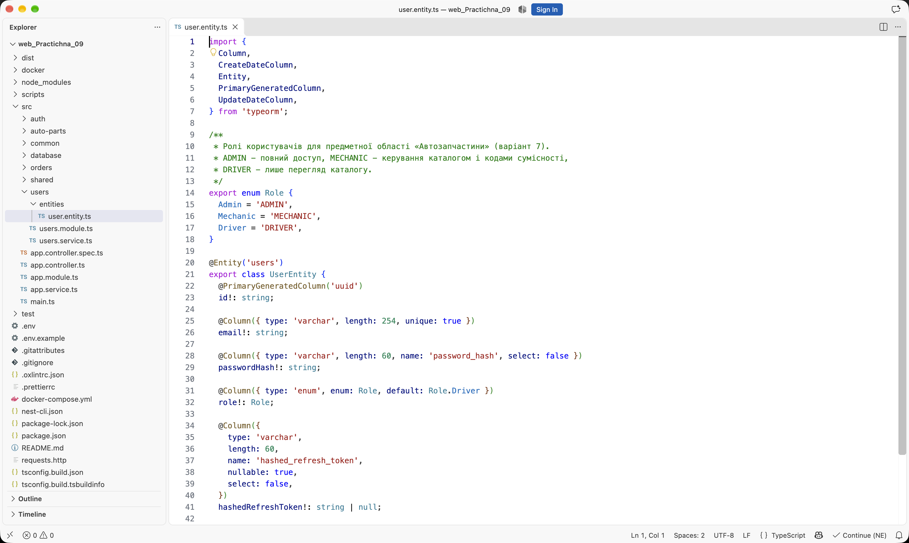

Реєстрація перевіряє формат email, довжину пароля та наявність у ньому літери й цифри. Повторний email повертає `409 Conflict`, пароль зберігається лише після `bcrypt.hash()` із 10 раундами солі, а новий користувач отримує роль `DRIVER`:

```ts
const passwordHash = await bcrypt.hash(dto.password, BCRYPT_ROUNDS);

const user = await this.usersService.create({
  email: dto.email,
  passwordHash,
  role: Role.Driver,
});
```

Під час входу сервіс явно дістає `passwordHash` із бази, порівнює його через `bcrypt.compare()` та формує корисне навантаження `{ sub, email, role }`. Для невірного email або пароля повертається однакова відповідь `401 Unauthorized` з текстом `Невірні облікові дані`, щоб не підказувати, яке саме поле неправильне:

```ts
const passwordMatches = await bcrypt.compare(dto.password, user.passwordHash);
if (!passwordMatches) {
  throw new UnauthorizedException('Невірні облікові дані');
}

const tokens = await this.issueTokenPair(user);
await this.saveRefreshTokenHash(user.id, tokens.refreshToken);
```

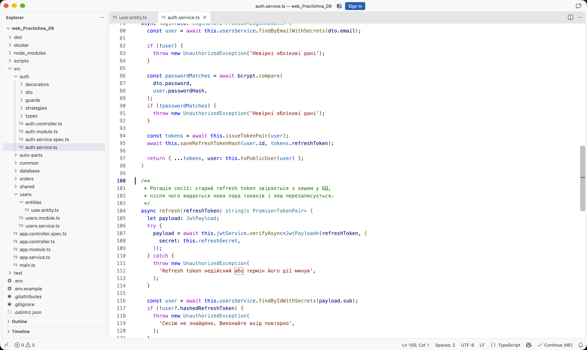

Маршрут `GET /auth/me` закритий гардом і повертає профіль без `passwordHash` та `hashedRefreshToken`. Перевірка на реальному запуску:

```text
1. Реєстрація нового користувача
  POST /auth/register -> 201
  role: DRIVER  email: demo.driver.950670@autoparts.local
OK реєстрація: очікували 201, отримали 201

2. Вхід водія та отримання пари токенів
  POST /auth/login -> 200
  accessToken: eyJhbGciOiJIUzI1NiIsInR5cCI6...
  Set-Cookie: refreshToken=...; Max-Age=604800; Path=/auth; HttpOnly; SameSite=Strict
OK вхід: очікували 200, отримали 200

3. Захищений профіль GET /auth/me
  GET /auth/me -> 200
  id: 0d53d227-74e1-47a4-9fcc-1b5b7080c76c  role: DRIVER
  passwordHash у відповіді: відсутній
OK профіль: очікували 200, отримали 200
```

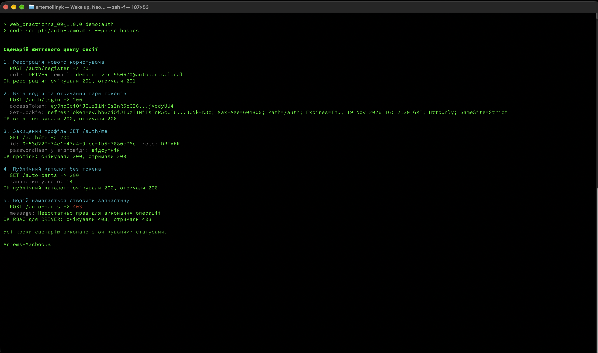

---

### Рівень 2. Кастомні декоратори, глобальний захист і RBAC

Декоратор `@Public()` записує у метадані обробника ознаку відкритого маршруту. Глобальний `JwtAuthGuard` читає цю ознаку через `Reflector` і пропускає публічні запити без перевірки заголовка `Authorization`:

```ts
canActivate(context: ExecutionContext) {
  const isPublic = this.reflector.getAllAndOverride<boolean>(IS_PUBLIC_KEY, [
    context.getHandler(),
    context.getClass(),
  ]);

  if (isPublic) {
    return true;
  }

  return super.canActivate(context);
}
```

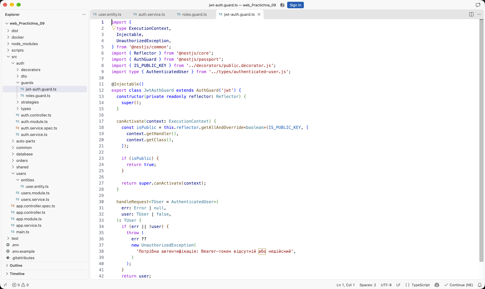

Декоратор `@CurrentUser()` дістає з `req.user` як весь обʼєкт, так і окреме поле. У контролері це виглядає коротко:

```ts
@Get('me')
me(@CurrentUser() user: AuthenticatedUser): Promise<PublicUser> {
  return this.authService.getProfile(user.id);
}

@Post('logout')
async logout(@CurrentUser('id') userId: string) {
  await this.authService.logout(userId);
}
```

`RolesGuard` порівнює роль із `req.user` із переліком, записаним декоратором `@Roles()`. Якщо ролі не збігаються, гард кидає `ForbiddenException` з потрібним текстом:

```ts
const requiredRoles = this.reflector.getAllAndOverride<Role[]>(ROLES_KEY, [
  context.getHandler(),
  context.getClass(),
]);

if (!request.user || !requiredRoles.includes(request.user.role)) {
  throw new ForbiddenException('Недостатньо прав для виконання операції');
}
```

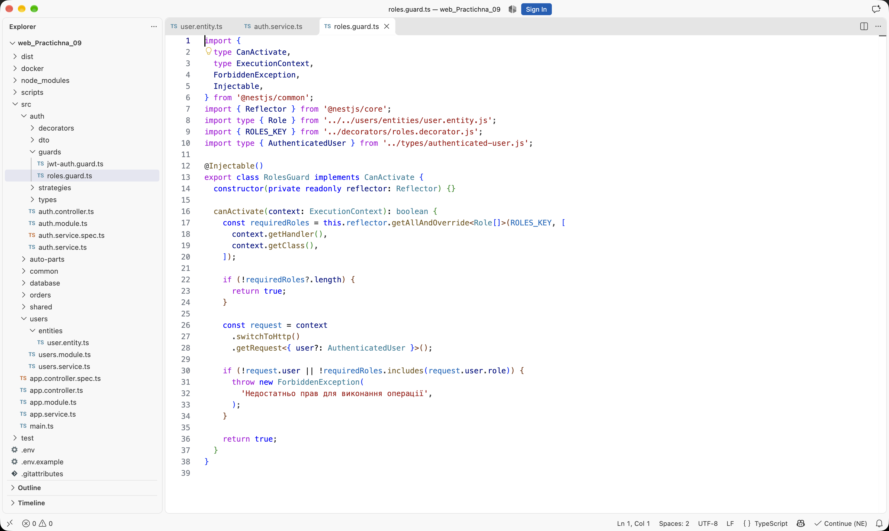

Обидва гарди підключені глобально в `AuthModule` у правильному порядку: спочатку перевіряється токен, потім роль. Модуль також реєструє `PassportModule` зі стратегією `jwt` і `JwtModule`:

```ts
providers: [
  AuthService,
  JwtStrategy,
  { provide: APP_GUARD, useClass: JwtAuthGuard },
  { provide: APP_GUARD, useClass: RolesGuard },
],
```

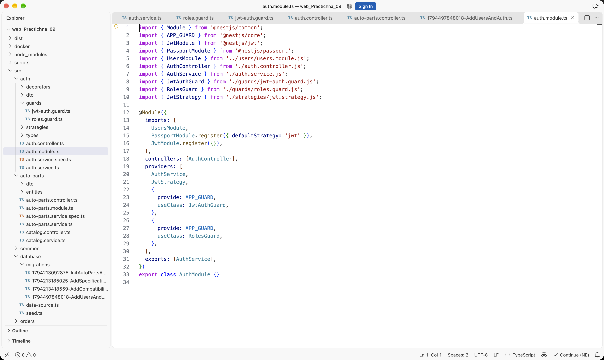

Мутуючі маршрути каталогу закриті декоратором `@Roles(Role.Admin, Role.Mechanic)`, а читання позначене `@Public()`. Для варіанта 7 окремо виділено маршрут додавання коду сумісності:

```ts
@Roles(Role.Admin, Role.Mechanic)
@Post(':id/compatibility-code')
upsertCompatibilityCode(
  @Param('id') id: string,
  @Body() dto: CompatibilityCodeDto,
) {
  return this.autoPartsService.upsertCompatibilityCode(id, dto);
}
```

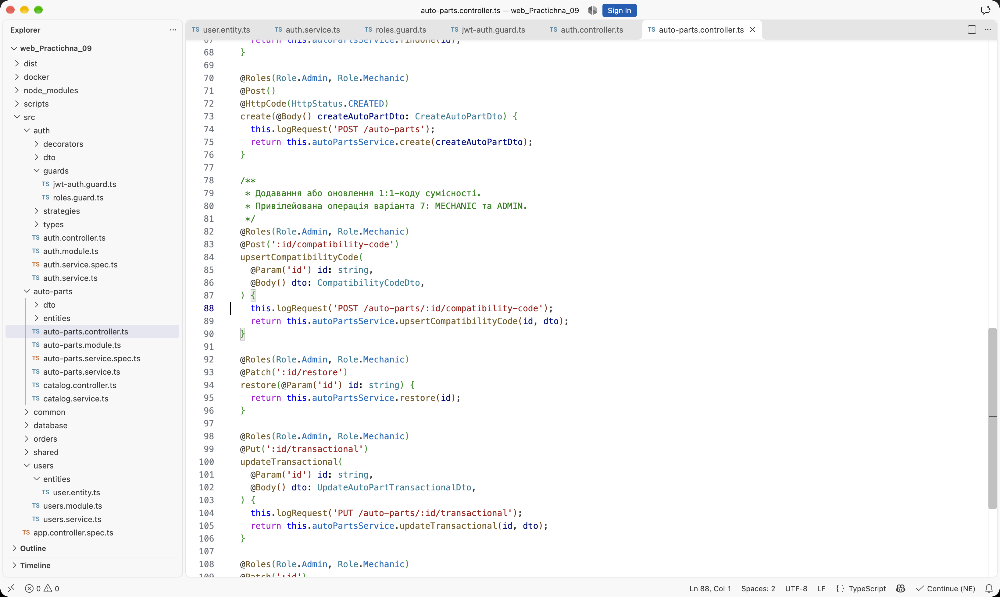

Перевірка розмежування доступу на реальних запитах:

| Запит | Роль у токені | Статус | Повідомлення |
|---|---|---|---|
| `GET /auto-parts?page=1&limit=2` без токена | - | `200` | каталог повернуто |
| `GET /auth/me` без токена | - | `401` | `Потрібна автентифікація: Bearer-токен відсутній або недійсний` |
| `POST /auto-parts` | `DRIVER` | `403` | `Недостатньо прав для виконання операції` |
| `POST /auto-parts` | `MECHANIC` | `201` | запчастину створено |
| `POST /auto-parts/:id/compatibility-code` | `MECHANIC` | `201` | код сумісності створено |

---

### Рівень 3. Сесія з refresh token, HttpOnly cookie та ротацією

У `main.ts` підключено `cookie-parser`, тому контролер читає cookie без ручного розбору заголовка:

```ts
import cookieParser from 'cookie-parser';

const app = await NestFactory.create(AppModule);
app.use(cookieParser());
```

Пара токенів має різні секрети та різний час життя. Access token діє 15 хвилин, refresh token - 7 днів. У кожен токен додається унікальний `jti`, щоб навіть два входи в одну секунду давали різні рядки:

```ts
const [accessToken, refreshToken] = await Promise.all([
  this.jwtService.signAsync(
    { ...payload, jti: randomUUID() },
    { secret: this.accessSecret, expiresIn: ACCESS_TOKEN_TTL_SECONDS },
  ),
  this.jwtService.signAsync(
    { ...payload, jti: randomUUID() },
    { secret: this.refreshSecret, expiresIn: REFRESH_TOKEN_TTL_SECONDS },
  ),
]);
```

Refresh token не зберігається у відкритому вигляді. Перед `bcrypt.hash()` токен стискається до SHA-256:

```ts
private digestToken(token: string): string {
  return createHash('sha256').update(token).digest('hex');
}
```

Це не косметична деталь. `bcrypt` враховує лише перші 72 байти пароля, а JWT довший за 300 байтів. Усі токени одного користувача мають однаковий початок, тому без попереднього SHA-256 старий і новий refresh token давали б однаковий хеш, і ротація нічого б не змінювала. Після стискання до 64 символів кожен байт токена впливає на результат.

Refresh token передається лише через `Set-Cookie` із прапорцями `HttpOnly`, `SameSite=Strict` та `Path=/auth`:

```ts
return {
  httpOnly: true,
  secure: process.env.NODE_ENV === 'production',
  sameSite: 'strict',
  path: '/auth',
  maxAge: REFRESH_COOKIE_MAX_AGE_MS,
};
```

Маршрут `POST /auth/refresh` бере токен із `req.cookies`, перевіряє підпис окремим секретом, звіряє його з хешем у базі, випускає нову пару та перезаписує хеш. Маршрут `POST /auth/logout` очищає поле `hashedRefreshToken` і видаляє cookie:

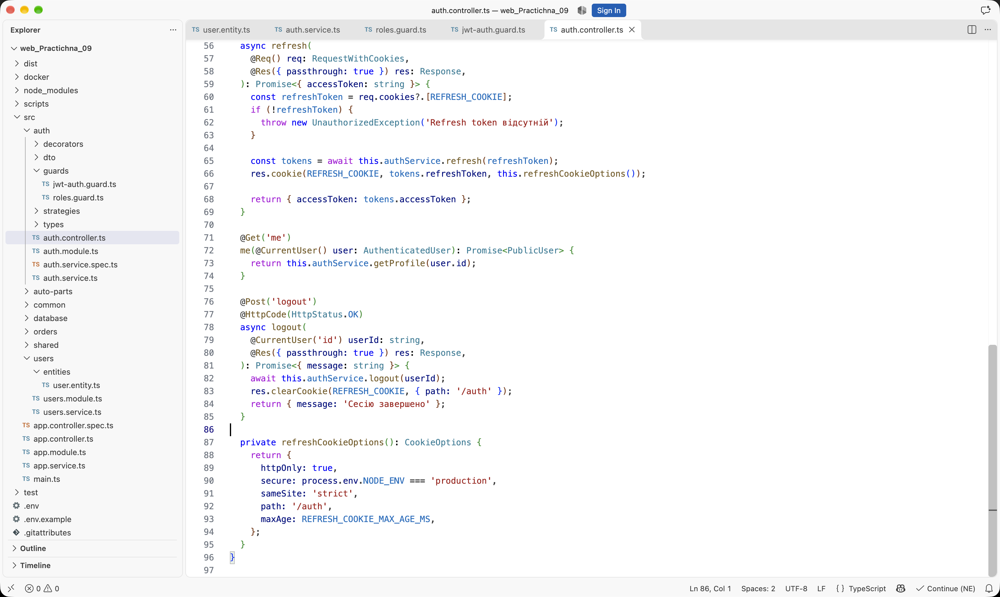

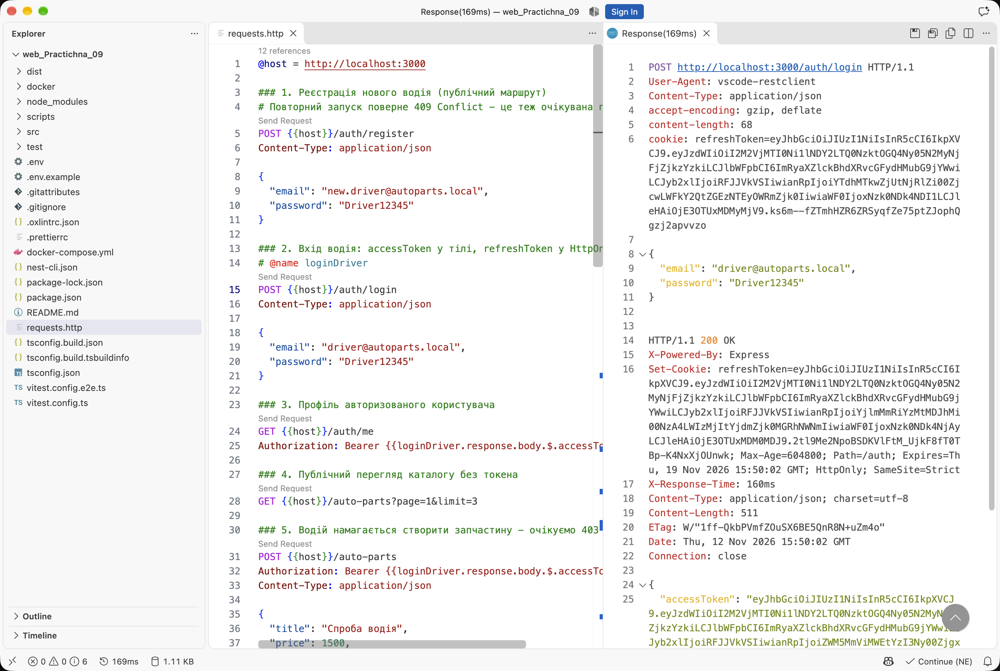

Повний сценарій життєвого циклу сесії:

| Крок | Запит | Статус | Що підтверджує |
|---|---|---|---|
| 1 | `POST /auth/register` | `201` | новий користувач отримує роль `DRIVER` |
| 2 | `POST /auth/login` | `200` | accessToken у тілі, refreshToken у cookie |
| 3 | `GET /auth/me` | `200` | токен прийнято, службових полів немає |
| 4 | `GET /auto-parts` | `200` | каталог відкритий без токена |
| 5 | `POST /auto-parts` від `DRIVER` | `403` | рольове обмеження працює |
| 6 | `POST /auth/login` від `MECHANIC` | `200` | інша роль отримує власну сесію |
| 7 | `POST /auto-parts` від `MECHANIC` | `201` | дозволена мутуюча операція |
| 8 | `POST /auto-parts/:id/compatibility-code` | `201` | код сумісності створено |
| 9 | `POST /auth/refresh` | `200` | пара токенів оновлена, cookie перевстановлена |
| 10 | `POST /auth/refresh` зі старим токеном | `401` | ротація анулювала попередній токен |
| 11 | `POST /auth/logout` | `200` | хеш у базі очищено, cookie видалена |
| 12 | `POST /auth/refresh` після виходу | `401` | сесію завершено остаточно |

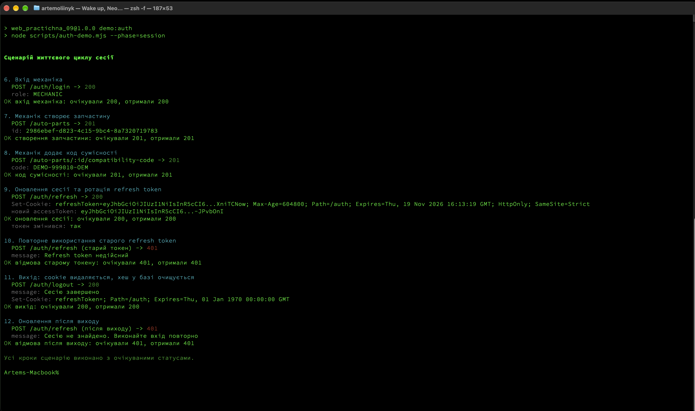

Окремо перевірено, що в базі немає відкритих паролів або refresh token. Обидва поля мають префікс `$2b$10$` і довжину 60 символів, а після виходу `hashed_refresh_token` стає `NULL`:

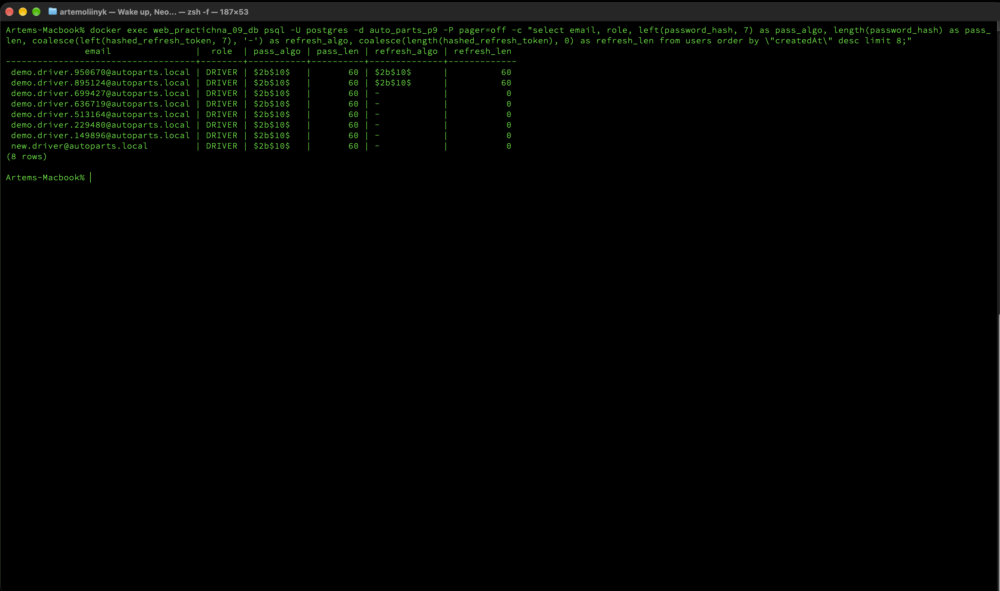

---

## Міграція та запуск

Схему доповнено четвертою міграцією, яка створює тип `users_role_enum` і таблицю `users`:

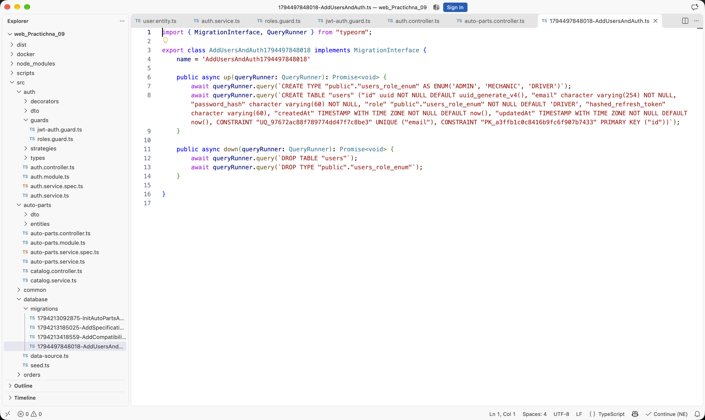

Стан міграцій після запуску:

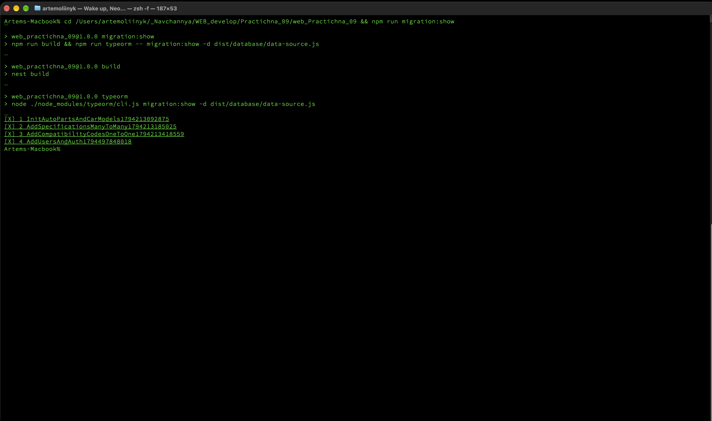

Сервер стартує без помилок і реєструє маршрути автентифікації та каталогу:

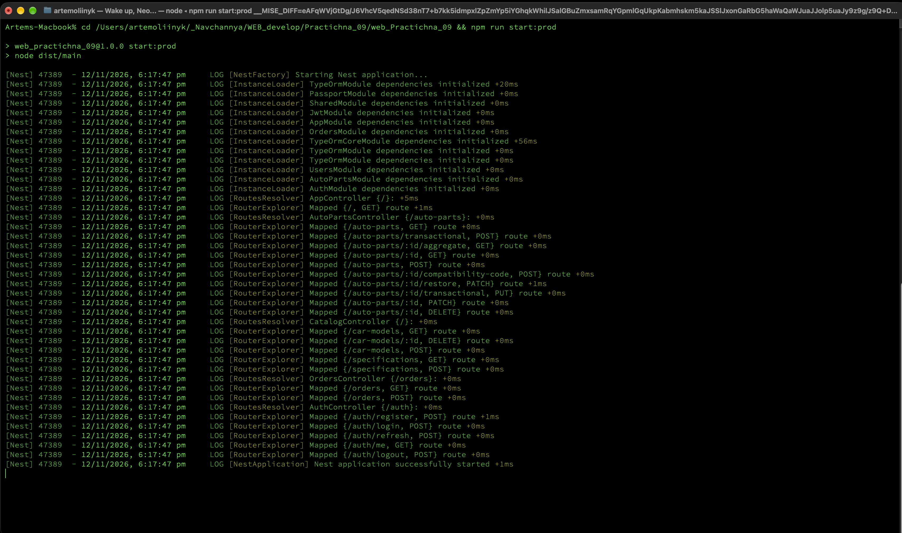

---

## Перевірка відсутності помилок

Збірка проходить без попереджень, тести - без падінь:

```text
> web_practichna_09@1.0.0 build
> nest build

> web_practichna_09@1.0.0 test
> vitest run

Test Files  3 passed (3)
     Tests  9 passed (9)
```

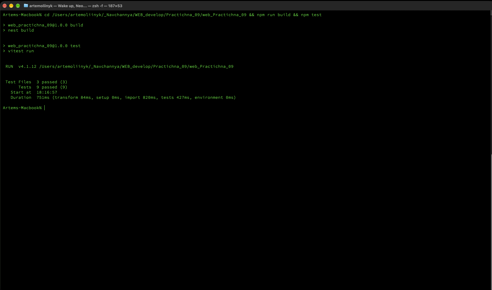

Що саме перевіряють тести `AuthService`:

- реєстрація хешує пароль, не повертає `passwordHash` і призначає роль `DRIVER`;
- неправильний пароль дає `UnauthorizedException`;
- refresh перевіряє хеш, випускає новий токен і перезаписує хеш у базі;
- токен, якого немає в базі, відхиляється;
- вихід очищає `hashedRefreshToken`.

Додатково перевірено вручну:

| Перевірка | Результат |
|---|---|
| `npm run build` | без помилок |
| `npm test` | 3 файли, 9 тестів пройдено |
| `npm run migration:show` | 4 міграції виконано |
| публічний каталог без токена | `200` |
| профіль без токена | `401` |
| створення запчастини водієм | `403` |
| створення запчастини механіком | `201` |
| повторне використання старого refresh token | `401` |
| refresh після виходу | `401` |

---

## Інструкція запуску

```bash
docker compose up -d
npm install
cp .env.example .env
npm run migration:run
npm run seed
npm run start:dev
```

У `.env` потрібно задати власні секрети. Приклад генерації:

```bash
openssl rand -hex 32
```

Значення записуються у `JWT_ACCESS_SECRET` і `JWT_REFRESH_SECRET`. Пароль бази та її назва вже узгоджені з `docker-compose.yml`: `auto_parts_p9` на порту `5433`.

Тестові користувачі створюються командою `npm run seed`:

| Email | Пароль | Роль |
|---|---|---|
| `admin@autoparts.local` | `Admin12345` | `ADMIN` |
| `mechanic@autoparts.local` | `Mechanic12345` | `MECHANIC` |
| `driver@autoparts.local` | `Driver12345` | `DRIVER` |

Після запуску сервер доступний на `http://localhost:3000`. Готові запити для REST Client зібрані в `requests.http`: реєстрація, вхід, профіль, перевірка 403, вхід механіка, створення моделі й запчастини, код сумісності, refresh, вихід і повторний refresh.

Повний сценарій можна відтворити однією командою:

```bash
npm run demo:auth
```

Окремі частини:

```bash
npm run demo:auth -- --phase=basics
npm run demo:auth -- --phase=session
```

Зупинка контейнера:

```bash
docker compose down
```

Дані зберігаються в томі `pgdata`, тому після звичайного `docker compose down` залишаються на місці.

---

## Схема бази даних

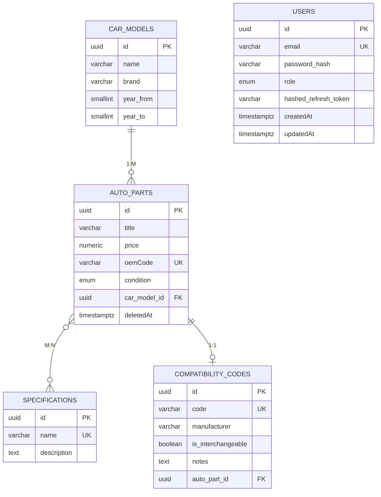

Таблиця `users` не пов'язана зовнішнім ключем із каталогом: у межах цієї роботи вона відповідає лише за вхід і роль. Це окремий модуль, який можна повторно використати в наступних роботах.

---

## Основні ендпоінти

| Метод | Маршрут | Доступ | Призначення |
|---|---|---|---|
| `POST` | `/auth/register` | публічний | реєстрація з роллю `DRIVER` |
| `POST` | `/auth/login` | публічний | accessToken у тілі, refreshToken у cookie |
| `POST` | `/auth/refresh` | публічний, лише cookie | ротація пари токенів |
| `GET` | `/auth/me` | будь-яка автентифікована роль | профіль без службових полів |
| `POST` | `/auth/logout` | будь-яка автентифікована роль | очищення хешу й cookie |
| `GET` | `/auto-parts` | публічний | пагінований каталог |
| `GET` | `/auto-parts/:id` | публічний | одна запчастина |
| `GET` | `/auto-parts/:id/aggregate` | публічний | повний агрегат 1:M + M:N + 1:1 |
| `POST` | `/auto-parts` | `ADMIN`, `MECHANIC` | створення запчастини |
| `PATCH` | `/auto-parts/:id` | `ADMIN`, `MECHANIC` | редагування |
| `DELETE` | `/auto-parts/:id` | `ADMIN`, `MECHANIC` | мʼяке видалення |
| `POST` | `/auto-parts/:id/compatibility-code` | `ADMIN`, `MECHANIC` | код сумісності |
| `GET` | `/car-models` | публічний | довідник моделей |
| `POST` | `/car-models` | `ADMIN`, `MECHANIC` | нова модель |
| `GET` | `/specifications` | публічний | довідник вузлів |
| `POST` | `/specifications` | `ADMIN`, `MECHANIC` | новий вузол |

---

## Висновки

Підсистему автентифікації побудовано навколо `UserEntity` з унікальним email і трьома ролями. Пароль ніколи не зберігається у відкритому вигляді: у таблиці лежить bcrypt-хеш із префіксом `$2b$10$`, а службові поля приховані від вибірок за замовчуванням. Реєстрація та вхід повертають зрозумілі українські повідомлення, а невірні облікові дані не розкривають, яке саме поле помилкове.

Глобальний `JwtAuthGuard` разом із `@Public()` дає єдину точку перевірки токена для всього застосунку. Завдяки `@Roles()` і `RolesGuard` звичайний водій бачить каталог, але не може його змінювати, тоді як механік і адміністратор створюють запчастини та коди сумісності. Перевірка на реальних запитах підтвердила `403` для `DRIVER` і `201` для `MECHANIC`.

Найбільше уваги потребувала робота з refresh token. Зберігання довгого JWT безпосередньо в `bcrypt` виглядає логічно, але через обмеження у 72 байти воно не розрізняє токени з однаковим початком. Попереднє стискання до SHA-256 вирішує цю проблему: ротація справді змінює хеш, старий токен отримує `401`, а після виходу оновлення стає неможливим. Cookie з `HttpOnly`, `SameSite=Strict` і `Path=/auth` закриває доступ до refresh token зі скриптів сторінки.

Окремо перевірено, що після `npm run build` немає помилок, усі 9 тестів проходять, а чотири міграції застосовані до чистої бази. Проєкт запускається за наведеною інструкцією, тестові користувачі створюються сідом, а повний сценарій сесії відтворюється командою `npm run demo:auth`.
